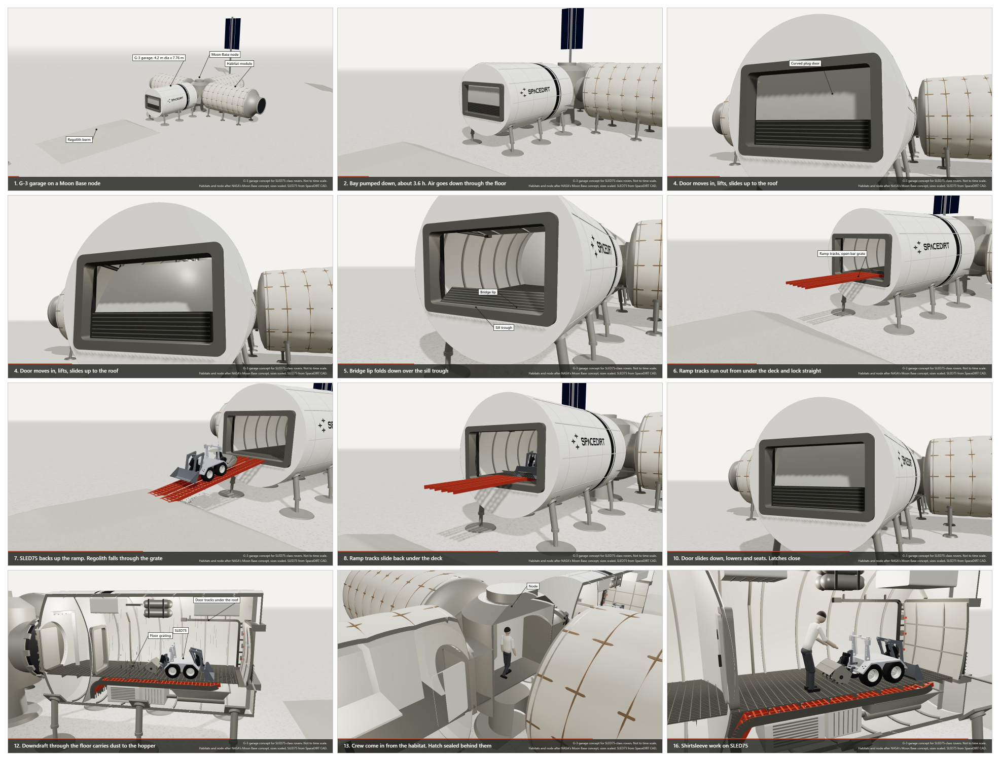

# Claude engineering animation

How SpaceDIRT and Claude (Anthropic's AI model, working in Claude Code) turn a first-order engineering sizing into a concept film. The example is G-3, a small pressurized garage that lets crew service SLED75-class rovers in shirtsleeves at a lunar base.



**The film:** [media/G3_sequence.mp4](media/G3_sequence.mp4). It runs 89 s at 1280 x 720 and 25 fps, H.264.

Shaun Riddell (CEO, SpaceDIRT) set the direction in plain chat messages. Claude ran the work: one main session, plus two helper agents for sizing and for the 3D scene and film. Everything was made the same day, 5 November 2026. [docs/prompts.md](docs/prompts.md) has his messages and the agent briefs, edited only to remove programme-restricted details.

## The pipeline

```
sizing script (node)  ->  geometry JSON  ->  three.js scene  ->  headless browser frames  ->  H.264 MP4
   first-order loads,      one source of      parametric, reads     one JPEG per frame,          encoded in the
   masses, clearances      truth for every    every dimension       resumable, survives          browser with
   (low / nominal / high)  position           from the JSON         browser crashes              WebCodecs
```

1. **Size it.** A plain Node script works out the geometry, loads, masses and clearances in low, nominal and high bands, with hand checks. It writes `design/G-3_geometry.json` with every dimension and pose the scene needs. The script itself isn't in this repo because it also carries restricted inputs; the JSON is its public output.
2. **Build the scene.** `scene/scene.js` reads the JSON at build time and builds a three.js scene. The scene has no dimension of its own, only placement and timing. `stateAt(t)` gives every moving part at film time `t`, and `cameraAt(t)` gives the camera.
3. **Render frames.** `tools/frames.cjs` drives headless Microsoft Edge through puppeteer-core with SwiftShader WebGL. It writes one JPEG per frame, skips frames already on disk, and relaunches the browser after a crash.
4. **Encode.** `tools/encode.cjs` feeds the JPEGs to the browser's `VideoEncoder` (H.264 High) and `mp4-muxer` (faststart).
5. **Check.** `tools/contact.cjs` builds a contact sheet without a browser. Claude then reads the stills and the decoded film frames itself, checking for parts passing through each other, label clashes and captions that don't match the action. Nothing is called clean while an issue is open.
6. **Viewer.** `scene/viewer_entry.js` plus `tools/mkview.cjs` make a single self-contained HTML file with play, scrub and orbit.

Details and commands: [docs/pipeline.md](docs/pipeline.md). How the work was split between agents: [docs/agents.md](docs/agents.md). What went wrong and what we changed: [docs/lessons.md](docs/lessons.md). The cleaned chat log of the session: [docs/chat.md](docs/chat.md).

## Run it

Needs Node 20 or later and Microsoft Edge (or Chrome: set `BROWSER` to its path).

```
npm install
npm run build:viewer          # G3_viewer.html, open it in a browser
npm run build:film            # then: npm run frames, npm run build:encoder, npm run encode
```

Two assets are not in this repo, and the build falls back without them:

| Asset | Why it is missing | Fallback |
|---|---|---|
| `scene/sled75_cad.bin`, SLED75 rover, loader and tiller mesh | SpaceDIRT's own CAD | A placeholder rover of the same overall size |
| `fonts/Azonix.otf`, the logo wordmark font | Licensed for personal use only | Bahnschrift |

The film in `media/` was rendered with both.

## What is here

| Folder | Contents |
|---|---|
| `scene/` | three.js scene, film and viewer entries, viewer template |
| `tools/` | build, frame render, encode, contact sheet, viewer packer |
| `design/` | `G-3_geometry.json` and the G-3 sizing figures (side, end, plan, door motion, mass) |
| `media/` | the film, its contact sheet and five stills |
| `docs/` | pipeline, agents, prompts, lessons, chat log |

## Status

G-3 is a first-order concept, not a design.
- **Shaun's calls:** the 4.2 m vessel, the curved one-piece door that moves in, lifts and slides up to the roof, the widest door the vessel allows, and the SLED75 class.
- **Claude's proposals,** unreviewed: everything else, including the ramp stowage, the latches and the equipment layout.
- **Open items:** the notes in `scene/scene.js` and the JSON list them, among them the ramp chain stowage and the tiller clearance on the 10 degree ramp.

Habitats and node are after NASA's Moon Base concept, with sizes scaled.

© SpaceDIRT 2026. All rights reserved. Shared for reference; ask before reuse.
